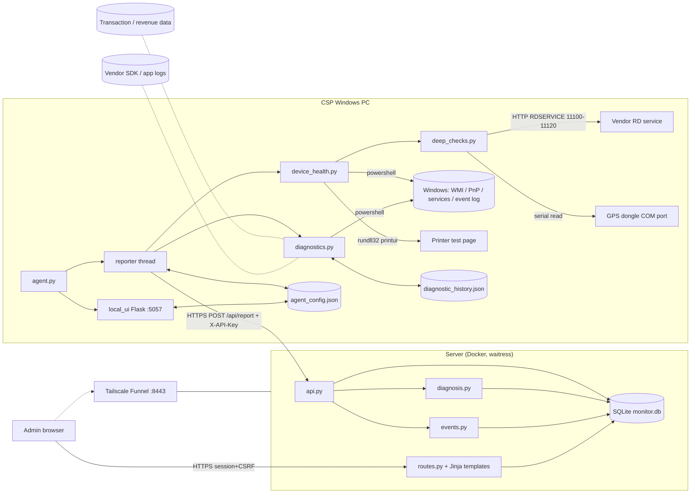
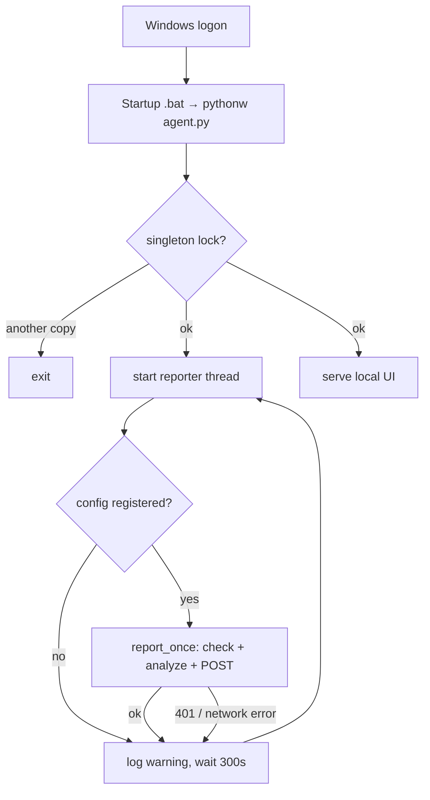
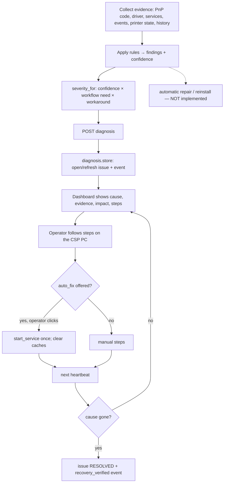
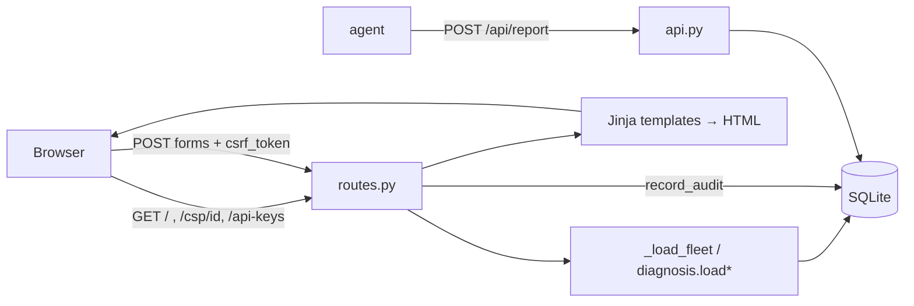

# CSP Device Monitor — Complete Architecture & Pipeline Analysis

*Analysis of the code as it exists at git commit `abcf3f9` (agent version `2.0.0`, payload `schema_version 4`).
Nothing in the codebase was modified to produce this document. Statements are based on reading the source
files named in each section; anything that could not be verified from the repository is listed in Section 15.
Secrets are never reproduced — only environment-variable **names** appear.*

**Verification performed:** all three test suites were run on this commit — agent 219 tests, server 116 tests,
tools 20 tests (including one real end-to-end test) — all passed; `git status` was clean afterwards (tests wrote nothing into tracked files).

---

# 1. Project overview and purpose

**What it is.** A fleet monitor for the Windows PCs at *Customer Service Points* (CSPs — small banking
agent outlets). Each CSP PC has up to four revenue-relevant peripherals:

| Device key | Real-world device | Likely business use (an *assumption*, see §10) |
|---|---|---|
| `printer` | Passbook printer | passbook printing / update |
| `microatm` | Micro-ATM card terminal | card withdrawal, balance enquiry |
| `biometric` | Fingerprint scanner (needs a vendor "RD Service") | Aadhaar-based transactions (AePS), eKYC |
| `gps` | USB GPS dongle | location capture for transactions (usage not established) |

**Problem it solves.** Operations want to know, centrally, which CSP's devices are failing so revenue-generating
services can be restored. Two programs implement this:

1. **Agent** (`agent/`) — a Python program installed on each CSP PC. Every 5 minutes it inspects Windows,
   decides the state of the four devices, and POSTs a JSON "heartbeat" to the server. It also serves a
   localhost-only setup page (`127.0.0.1:5057`).
2. **Server** (`server/`) — a Flask + SQLite web app. It authenticates each agent by API key, stores the latest
   state and history, and shows an admin dashboard (fleet table, per-CSP detail, API-key management, audit log).

**Companion tooling** (`tools/`) builds per-CSP install zips and a "switch server address" zip; they are admin
utilities, not part of the runtime.

**What it is not.** It has no AI/ML component. Every decision is deterministic rule code (Section 6). It does not
touch customer or biometric data and does not perform or test financial transactions.

**Deployment as documented / as evidenced.** The server runs in Docker (`server/Dockerfile`, waitress on port 5100)
behind Tailscale Funnel (`DEPLOYMENT.md`). Agents are delivered by hand as zip files and updated by copying files
(there is no auto-update). *The live container/compose file lives on the rack server and is not in the repo (§15).*

---

# 2. Complete folder and file structure

Root: `C:\Users\ASUS\Downloads\csp-device-monitor` (git repo; remote `thakurnischay/csp-monitor-device-agent`).
Line counts are from `wc -l`.

```
csp-device-monitor/
├── agent/                         ← runs on each CSP PC (≈3,800 lines of Python)
│   ├── agent.py            (65)   entry point: logging, singleton, reporter thread + local UI
│   ├── reporter.py        (225)   heartbeat loop, payload build, HTTP POST, size guard
│   ├── device_health.py  (1043)   Windows scans, device matching, recognition, verification
│   ├── deep_checks.py     (344)   RD-service probe, GPS NMEA read
│   ├── diagnostics.py     (984)   evidence collection, rules, severity, history, service-start fix
│   ├── impact_map.py       (91)   device → business workflow mapping (assumptions)
│   ├── local_ui.py        (643)   localhost Flask setup page + endpoints (page is an embedded string)
│   ├── config_store.py    (129)   agent_config.json read/write
│   ├── singleton.py        (67)   one-agent-per-PC PID lock
│   ├── diagnose.py        (209)   support tool: dumps what the agent sees → agent-diagnostic.txt
│   ├── version.py           (9)   AGENT_VERSION="2.0.0", SCHEMA_VERSION=4
│   ├── SETUP.bat / install_task.ps1 / uninstall_task.ps1 / DIAGNOSE.bat / INSTALL_FOR_CSP.txt
│   ├── requirements.txt           flask==3.0.3, requests==2.32.3
│   ├── wheels/                    offline Python packages (cp310–cp313, win_amd64) – not tracked in git
│   └── tests/ (10 test files, 219 tests)
├── server/                        ← the central dashboard + API (≈1,300 lines of Python)
│   ├── app.py             (146)   Flask app factory, logging, CSRF, security headers, template filters
│   ├── api.py             (239)   /api/report, /health, /readiness, /api/v1
│   ├── routes.py          (364)   admin UI: login, fleet, fleet.csv, csp detail, api-keys, audit-log
│   ├── diagnosis.py       (194)   validate + store the agent's diagnosis; issue lifecycle
│   ├── device_state.py     (72)   derived device/CSP states
│   ├── events.py           (65)   events, incidents, audit writes
│   ├── db.py              (122)   SQLite connection (WAL), schema setup, additive migrations
│   ├── schema.sql         (140)   table definitions
│   ├── security.py        (107)   API-key hashing, CSRF, in-memory rate limiter
│   ├── auth.py             (14)   admin password hashing (werkzeug)
│   ├── templates/ base, login, fleet, csp_detail, api_keys, audit_log, not_found
│   ├── static/app.js       (33)   copy-to-clipboard + auto-submit (no inline JS: CSP forbids it)
│   ├── Dockerfile / run.sh / requirements.txt (flask, werkzeug, waitress)
│   └── tests/ (8 test files + helpers.py, 116 tests)
├── tools/                         ← admin utilities (not runtime)
│   ├── make_csp_zips.py + MAKE_CSP_ZIPS.bat + csp_list.example.csv   per-CSP pre-filled install zips
│   ├── make_address_switch_zip.py + address_switch/change_address.py  move installed agents to a new URL
│   └── test_*.py (20 tests incl. real agent↔server end-to-end)
├── *.md                           ← README, ARCHITECTURE, API, DEPLOYMENT, OPERATIONS, SECURITY, AUDIT,
│                                    PRODUCTION_READINESS, TROUBLESHOOTING, AGENT_INSTALLATION, DIAGNOSTICS
├── deploy_*.txt, diagnose_csp_pc.txt   ← historical copy-paste runbooks (some contain old inline patch scripts)
├── demo/            (gitignored)  run_demo.py + logs: runs the setup page with a throwaway config
├── local-run/       (gitignored)  an OLD copy of the server (api/app/db/routes differ from server/) + a monitor.db
├── csp-device-monitor/ (untracked) a STALE nested copy of an early agent/docs (differs from agent/ in 10+ files)
└── test_old_install/ (untracked)  empty
```

`server/.env` exists locally (gitignored) and is read by `run.sh`; its contents were not inspected or reproduced.

**Inspected vs. not inspected** is recorded in §15.

---

# 3. Current architecture

```
┌────────────── CSP Windows PC ──────────────┐            ┌────────────── Server (Docker) ──────────────┐
│  Startup .bat → pythonw agent.py           │            │  waitress :5100  →  Flask app (app.py)       │
│   ├─ thread: reporter._loop  (every 300 s)─┼──HTTPS────►│   api_bp   POST /api/report (X-API-Key)      │
│   │    device_health.check()  (PowerShell) │  JSON      │   ui_bp    login / fleet / csp / api-keys    │
│   │    diagnostics.analyze()  (PowerShell) │            │  SQLite (monitor.db, WAL) on a Docker volume │
│   └─ main: local_ui (Flask 127.0.0.1:5057) │            │   csps · api_keys · events · incidents ·     │
│  agent_config.json · diagnostic_history.json│           │   device_diagnosis · device_issues ·         │
│  (API key stored in plaintext locally)     │            │   admin_users · admin_audit_log              │
└────────────────────────────────────────────┘            └──────────────────▲───────────────────────────┘
                                                                              │ Tailscale Funnel :8443 (public TLS)
                                                          Admin browser ──────┘  (session cookie + CSRF)
```

Key properties:
- **Pull-free, push-only.** The server never contacts agents. All data flows agent → server over one endpoint.
- **Agent identity = API key.** The server accepts a report only if the key's hash matches the key issued for the
  `csp_id` in the body (`api._valid_key`). There is no per-agent certificate.
- **Two parallel status models coexist**: a *legacy* flat model (per-device `configured/present/ok/status/verified`
  columns on `csps`, plus `incidents`) and a newer *diagnosis* model (`device_diagnosis` + `device_issues`). The server
  chooses per device which one drives events/incidents (`diag_handled` in `api.report`).
- **Single process, single SQLite file.** In-memory rate limiter and sessions imply one server process.

---

# 4. End-to-end execution pipeline, step by step

Format per step: *trigger → code → input → processing → output → next → on failure*.

## 4.A Installation and first start (CSP PC)

1. **Trigger:** an admin/CSP extracts the zip and double-clicks `agent/SETUP.bat`.
   **Does:** locates Python (`python -c "import sys"` – avoids the Windows Store stub), downloads/installs Python 3.12.6 silently if absent;
   installs packages — first **offline** from `wheels/` (`pip --no-index --find-links`), else online with `--default-timeout=120 --retries 10` × 4 attempts;
   then runs `powershell install_task.ps1 -PythonPath …`. **Failure:** prints a message and `pause`s; exits non-zero.
2. **`install_task.ps1`** writes `…\Startup\CSPDeviceMonitorAgent.bat` (`start "" pythonw agent.py`), kills any previous `agent.py`
   processes (CIM `Win32_Process` filter) and launches `pythonw agent.py`. (Starts at *user logon*, not at boot; no Scheduled Task despite the filename.)
3. **`SETUP.bat`** then opens `http://127.0.0.1:5057` — the agent's local setup page.
4. **`agent.py:main()`** — configures a rotating `agent.log` (2 MB × 2), calls `singleton.acquire_or_exit()` (PID file lock; a second copy exits),
   installs SIGINT/SIGTERM handlers, **starts `reporter.start_background()`** (daemon thread) and then **blocks in `local_ui.run()`**
   (Flask dev server, `127.0.0.1:5057`). On exit it releases the singleton.

## 4.B One-time setup on the CSP (human steps)

5. In the local page the person enters **Server URL, CSP Code, API key** → `POST /configure` (`local_ui.configure`) →
   `config_store.save()` writes `agent/agent_config.json` (whitespace stripped — a past "invalid key" bug). *The key is stored in plaintext on the PC.*
6. The person picks the four devices from dropdowns (`<input list>` + a visible `<select>`), or runs **Find my device** (Step 1/2 → `/snapshot`, `/detect`, `/confirm`),
   then **Save device selection** (`POST /configure`). `/configure` also auto-confirms an entry the plug-in test just found.
7. Alternatively an admin pre-fills `agent_config.json` using `tools/make_csp_zips.py` (per-CSP zip) — then only device selection remains.

## 4.C The heartbeat (every 300 s, forever)

8. **Trigger:** `reporter._loop` wakes (`_stop_event.wait(max(30, interval_seconds))`, default 300; first run is immediate).
9. `reporter.report_once()`:
   - `config_store.load()`; if not `is_registered` (needs `csp_id`, `api_key`, `server_url`) → returns `{"ok":False,"error":"agent not registered yet…"}` (logged as a warning; loop continues).
   - `build_payload(cfg)` (below). On any exception inside diagnosis the payload still goes out without it.
   - `requests.post(<server_url>/api/report, headers X-API-Key, json=payload, timeout=(5,15))`, up to 2 attempts (one retry after 2 s).
     **401** → returns an error immediately (no retry). Other errors → "could not reach server". **There is no offline queue: a failed report is dropped.**
10. **`build_payload`** (reporter.py) in order:
    1. `device_health.check(...)` → inside a 75 s ceiling (`run_with_ceiling`) → `_check_impl`:
       - `_scan_everything()` runs **3 PowerShell scans in parallel**: `list_printers()` (WMI `Win32_Printer`), `list_usb_devices()` and `list_all_devices()`
         (both `Get-PnpDevice -PresentOnly`, selecting FriendlyName/Class/Status/Manufacturer/InstanceId/ConfigManagerErrorCode/ProblemDescription).
         Empty "all devices" = scan failed → reuse `_last_good` lists and set `scan_problem`.
       - Builds per-device candidate lists (printers + COM ports/USB-print entries; USB devices; biometric; GPS), ranks them (`rank_devices`).
       - Resolves each device's name (`resolve_printer/microatm/biometric/gps`, honouring a human-confirmed identity), then computes status dicts
         (`printer_status`, `microatm_status`, `biometric_status`, `gps_status`) → `{configured, present, ok, status, recognised, _row}`.
       - Tracks confirmed devices by instance-id / USB VID:PID fingerprint (`_resolve_confirmed_device`, handles port moves), judges the vendor-recognised entry among same-named generics (`_prefer_recognised_same_name`).
       - Folds in the software process check (`process_running` → `tasklist`) via `_apply_software_signal`.
       - `deep_checks.apply_biometric_rd_check` (RD HTTP probe) and `apply_gps_nmea_check` (serial read).
       - Returns the health dict + raw candidate lists + `scan_problem`.
    2. `config_store.sync_resolved_device` / `sync_moved_device` write auto-detected names and moved-device identities back to `agent_config.json`.
    3. `_maybe_run_printer_functional_test` — at most **once per calendar day**, only for a real, non-virtual, ready Windows printer: runs
       `rundll32 printui.dll,PrintUIEntry /k /n <printer>` (**prints a real test page**), waits 6 s, reads `Win32_PrintJob` for error statuses.
    4. `device_health.apply_verification` — marks each healthy device `verified` only through evidence (RD READY / GPS data / known brand / plug-in test / test print / software running).
    5. `diagnostics.analyze` — evidence collection + rules (§6.4) → per-device diagnosis.
    6. Strips `_`-prefixed keys, adds `schema_version`, `agent_version`, `os`, `hostname`, `csp_id`, `reported_at`, `printer_functional_test`, `diagnosis`; `_fit()` trims to ≤150 KB.
11. **Output:** HTTP POST. **Next:** server `api.report` (§7).
12. **Failure semantics:** a failure anywhere in checks degrades to "could not be checked", never an exception out of the loop (most functions are `try/except` wrapped).
    *Measured on a real PC (no mocks): ≈8 s per heartbeat, ≈5 KB payload.*

## 4.D Server handling of a heartbeat — `api.report()`

13. `report_limiter.allow(csp_id)` (6 reports / 60 s per csp_id, in memory) → else **429**.
14. `_valid_key(conn, csp_id, key)`: `SELECT api_key_hash, active FROM api_keys WHERE csp_id=?`; active must be 1 and `sha256(key)` must equal the stored hash (`hmac.compare_digest`) → else **401** (logged without the key).
15. `UPDATE api_keys SET last_used_at`.
16. Upsert `csps` row (legacy flat fields: printer/microatm configured/present/ok/status, test-print fields, agent metadata, `last_seen`). `name` is taken from `api_keys.name` (admin label is authoritative).
17. `UPDATE csps SET printer_verified/microatm_verified = COALESCE(?, …)`.
18. `diagnosis.store(...)` — validates/clips each device's diagnosis, upserts `device_diagnosis`, opens/refreshes/resolves `device_issues`, records events `<dev>_issue_opened` / `<dev>_recovery_verified`. Returns the set of devices it handled.
19. For devices **not** in that set: legacy `derive_device_state` old→new → `events.apply_device_transition` (events + `incidents`).
20. biometric/gps legacy columns updated only if the payload contains those keys (older agents leave stored values untouched).
21. Test-print event if a *fresh* result arrived. `commit`. Response `{"ok":true,"received_at":…}`.

## 4.E Admin viewing

22. Admin logs in (`routes.login`: per-IP limiter 8/min; `admin_users`; `session["admin_in"]`; audit "login"), opens `/` → `routes.fleet` → `_load_fleet(conn)` (all `csps` rows + `diagnosis.load_all`) → derives CSP state from `last_seen` (Online <15 min, Stale <60 min, Offline otherwise), per-device state, counts for KPI cards, filters/sorts in Python, paginates (50) → `fleet.html`.
23. `/csp/<id>` → `csp_detail` loads the CSP row, `device_diagnosis`, `device_issues`, `events` (25), `incidents` → `csp_detail.html`.
24. `/api-keys` issues/rotates/revokes/deletes keys (plaintext shown once); `/audit-log` last 200 rows; `/fleet.csv` exports the filtered fleet.

## 4.F Operator-approved remediation (agent-side)

25. In the local page, a finding with `auto_fix` shows **Start it now** → `confirm()` → `POST /fix` (`local_ui.fix`) re-runs check + `analyze` and calls `diagnostics.start_service(service, diagnosis)`:
    only a service named in the *current* diagnosis, valid name regex, 6-hour cooldown after a failed attempt, `Start-Service` via PowerShell, result recorded in `diagnostic_history.json`, caches cleared so recovery is verified on the next check.
    **Nothing is ever fixed automatically.**

---

# 5. Component-by-component explanation

## 5.1 Agent

| File | Responsibility | Key functions |
|---|---|---|
| `agent.py` | process entry; wires logging, singleton, reporter thread, local UI | `main()`, `_handle_shutdown_signal()` |
| `singleton.py` | prevents two agents (each has its own config); PID lock file `agent/agent.lock` + `tasklist` to detect a stale lock (no psutil) | `acquire_or_exit()`, `release()`, `_pid_is_running()` |
| `config_store.py` | JSON config at `agent/agent_config.json` (override env `CSP_AGENT_CONFIG_PATH`); defaults incl. device names, confirmed identities (`*_confirmed`, `*_instance`, `*_fingerprint`), `interval_seconds` | `load()`, `save()`, `is_registered()`, `sync_resolved_device()`, `confirmed_map()`, `sync_moved_device()` |
| `reporter.py` | loop + payload + POST + daily test print | `_loop()`, `report_once()`, `build_payload()`, `_fit()`, `_maybe_run_printer_functional_test()` |
| `device_health.py` | all Windows device discovery and matching (details §6.1) | `_run_ps()`, `list_printers/usb_devices/all_devices()`, `check()`, `_check_impl()`, `_scan_everything()`, `*_status()`, `resolve_*()`, `apply_verification()`, `_resolve_confirmed_device()`, `fingerprint()`, `printer_functional_test()`, `process_running()` |
| `deep_checks.py` | RD-service HTTP probe; GPS serial read | `probe_rd_services()`, `apply_biometric_rd_check()`, `read_nmea()`, `apply_gps_nmea_check()`, `debug_serial()` |
| `diagnostics.py` | evidence + rules + history + fix | `collect()`, `analyze()`, `diagnose_device()`, `_device_rules()`, `_cm_finding()`, `_service_findings()`, `_printer_findings()`, `severity_for()`, `class History`, `start_service()` |
| `impact_map.py` | device → workflow assumptions, optional `impact_map.json` override | `load()`, `describe()` |
| `local_ui.py` | localhost setup/diagnosis UI | routes `/`, `/status`, `/snapshot`, `/detect`, `/confirm`, `/fix`, `/configure`, `/report_now` |
| `diagnose.py` | support dump tool | `main()` |

## 5.2 Server

| File | Responsibility | Key functions |
|---|---|---|
| `app.py` | factory; **module import runs `_configure_logging()`, `db.setup()`, `create_app()`** (side effects on import) | `create_app()`; filters `ist`, `relative_time`; `_csrf_protect`, `_security_headers` |
| `api.py` | agent-facing endpoints | `report()`, `_valid_key()`, `_verified()`, `readiness()`, `health()` |
| `routes.py` | admin UI | `login`, `fleet`, `_load_fleet`, `_device_problem`, `fleet_csv`, `csp_detail`, `api_keys`, `audit_log` |
| `diagnosis.py` | ingest + read diagnosis | `store()`, `clean_finding()`, `load()`, `load_all()`, `issues_for()` |
| `device_state.py` | state vocabulary | `derive_device_state()`, `derive_csp_state()` |
| `events.py` | audit/event/incident writes | `record_event()`, `record_audit()`, `apply_device_transition()` |
| `db.py` | SQLite WAL connection, `setup()`, `_migrate_csps_columns()`, `_migrate_api_keys_table()` (one-time plaintext→hash migration) | |
| `security.py` | `generate_api_key()` (32-byte urlsafe), SHA-256 hash, CSRF token, `RateLimiter` | |

---

# 6. Agent detection and decision-making logic

**There is no AI/ML anywhere.** All logic is fixed rules: keyword lists, Windows error-code tables, thresholds.

## 6.1 Discovery & identification (`device_health.py`)

- **Windows queries (all via spawned `powershell -NoProfile`, `_run_ps`)**: `Win32_Printer` (name, `PrinterStatus`, `WorkOffline`);
  `Get-PnpDevice -PresentOnly` (name, class, status, manufacturer, InstanceId, `ConfigManagerErrorCode`, `ProblemDescription`) — executed **twice** (usb-class filtered and unfiltered).
- **USB classes considered USB-like:** `USB, HIDClass, Ports, SmartCardReader, Biometric`.
- **Recognition** is *name/maker/USB-vendor-id keyword matching* — `_KNOWN_PRINTER_BRANDS`, `_KNOWN_MICROATM_BRANDS`, `_KNOWN_BIOMETRIC_BRANDS`, `_KNOWN_GPS_BRANDS`, `_USB_VENDORS` (e.g. `2C0F` Mantra, `225D` Morpho, `0B00` Ingenico). Generic serial-chip IDs (CH340/FTDI/Prolific) are deliberately not treated as GPS.
- **Selection:** a human picks from a dropdown, or the agent self-configures when exactly one recognised device exists (`resolve_*`). A human-confirmed device (**Find my device**) is tracked by instance-id, then by hardware fingerprint (VID/PID/interface) so it survives a USB-port move.
- **Virtual devices** are excluded (`is_likely_virtual_printer`: PDF, fax, OneNote, AnyDesk…; `is_likely_virtual_usb_device`: names containing "enum").
- **`ok`** at this layer = Windows `Status == "OK"` (devices) or `PrinterStatus ∈ {Idle, Printing, Warming up}` and not `WorkOffline` (printers). *This alone only proves "listed and driver status OK".*

## 6.2 Verification (what "OK" is allowed to mean) — `apply_verification`
A healthy device is `verified` only if one of: RD service READY / GPS data seen; name/maker/VID matches a known brand; the person confirmed it with Find my device; a real printer accepted today's test page; the micro-ATM's configured process is running. Otherwise it is **Unverified** (never a green OK on the dashboard).

## 6.3 Deep checks (`deep_checks.py`)
- **Scanner RD service:** HTTP request with method `RDSERVICE` to `127.0.0.1:11100–11120` (21 ports in parallel, 0.6 s timeout), parsed for `status="READY|NOTREADY"`. READY ⇒ verifies. NOTREADY is *only a note* (Morpho reports it until first use). No capture, no device query.
- **GPS dongle:** if the device name contains `(COMx)`, a PowerShell `System.IO.Ports.SerialPort` read (DTR/RTS on; 9600/4800/38400/115200 baud, ~2 s each) looks for NMEA sentences. Data ⇒ verified; silence/busy/unreadable ⇒ *note only, never a fault*.

## 6.4 Diagnosis (`diagnostics.py`) — evidence → rules → findings
**Evidence collected** (`collect()`, parallel, cached by TTL): `Win32_Service` (all services; 60 s), `Win32_PnPSignedDriver` (6 h), System event log last 24 h for providers *Service Control Manager / Kernel-PnP / USBHUB3 / UserPnp* (10 min; only SCM IDs 7000/7001/7009/7011/7023/7024/7031/7034 are used), `Win32_Printer` detail (30 s), `Win32_PrintJob` (30 s). `None` = query failed; `[]` = checked, nothing.

**Rules (all deterministic):**
- *Device Manager error code* → `CM_CODES` table (≈25 codes) → state `DRIVER_ISSUE / SOFTWARE_ISSUE / SUSPECTED_HARDWARE / NOT_CONNECTED / DEGRADED / DIAGNOSIS_REQUIRED` with a confidence (confirmed/likely/possible) and fixed step lists.
- *Vendor service* (matched by keywords in service name/display, excluding Windows' own via path/name): Auto-start but not running ⇒ `SERVICE_STOPPED:<name>` (confirmed) with an operator-approved `auto_fix`; ≥2 crash events/24 h ⇒ `SERVICE_CRASHING`.
- *Scanner*: running service but no RD answer ⇒ `RD_NOT_RESPONDING` (likely); no service and no RD answer on a recognised scanner ⇒ `RD_NOT_FOUND` (possible, low).
- *Printer*: `DetectedErrorState` map (paper out/jam/door/offline/ribbon), `WorkOffline`, stopped Spooler, jobs older than 30 min, test-print failure (3 failures over ≥2 days with everything else normal ⇒ suspected hardware).
- *Micro-ATM*: configured process not running ⇒ `APP_NOT_RUNNING`.
- *Any device*: ≥3 disappearances in 24 h (from `History`) ⇒ `REPEATED_DISCONNECTS` (suspected hardware); not present ⇒ `NOT_CONNECTED` (medium if seen in the last 7 days, else low).

**Severity (`severity_for`)** = confidence × "does the mapped workflow require this device" × "is there a workaround" (from `impact_map`). Confirmed + required + no workaround ⇒ **high**; likely ⇒ medium; possible ⇒ low; **critical** only if ops marked the workflow `confirmed:true` or ≥2 devices have confirmed high failures at the same CSP. GPS impact is "not established" ⇒ capped at medium.

**Impact & revenue.** `impact_map.DEFAULT_IMPACT` is a **hard-coded assumption** (e.g. biometric → "Aadhaar-based transactions (AePS)…"), each flagged `confirmed:false`. Revenue is never estimated: text is always "Not calculable: no transaction or revenue data is connected."

**Recovery verification.** `History.reconcile` compares open issue codes between checks; a code that disappears is recorded and surfaces as `verification.status = recovery_verified` (24 h). The server independently resolves any issue absent from the next report.

**Recommendations** are static strings written in the rule code (e.g. "Install the vendor-approved driver…"). **Actions:** only `start_service` (operator click, once, cooldown 6 h). **No** automatic repair, driver install, restart-loop or reinstall.

**History** (`diagnostic_history.json`, next to the agent): presence transitions, last-present, last-healthy, test-print results, actions, open codes, recovered codes (30-day prune).

---

# 7. Backend, API and database flow

## 7.1 Endpoints

| Method & path | Auth | Purpose | Notes |
|---|---|---|---|
| `POST /api/report` | `X-API-Key` header + `csp_id` in body | agent heartbeat | 256 KB cap (`MAX_CONTENT_LENGTH`), 6/min/csp_id, 401 invalid, 429 limited |
| `GET /health` | none | liveness (no DB) | `{"ok":true,"status":"running"}` |
| `GET /readiness` | none | DB reachable | 200 `{"ok":true,"status":"ready","database":"ok"}` / 503 |
| `GET /api/v1` | none | lists endpoints (informational) | the real endpoint is unversioned `/api/report` |
| `GET,POST /login`, `GET /logout` | session | admin auth | 8 attempts/min/IP |
| `GET /` | session | fleet (query: `q,status,problems_only,sort,dir,page,refresh`) | refresh is a `<meta refresh>` 0/30/60 |
| `GET /fleet.csv` | session | CSV of the current filter | |
| `GET /csp/<csp_id>` | session | detail | 404 template if unknown |
| `GET,POST /api-keys` | session + CSRF | issue/rotate/toggle/delete keys | plaintext key shown once |
| `GET /audit-log` | session | last 200 audit rows | |

Agent-local (127.0.0.1:5057, no auth): `GET /`, `GET /status`, `POST /snapshot|/detect|/confirm|/fix|/configure|/report_now`.

## 7.2 Heartbeat request (shape from `reporter.build_payload`; **illustrative values**)
```json
POST /api/report     X-API-Key: <key>
{
  "schema_version": 4, "agent_version": "2.0.0", "os": "Windows-10-…", "hostname": "DESKTOP-XXXX",
  "csp_id": "1A850xxx", "reported_at": "2026-10-19T10:00:00+00:00",
  "printer":  {"configured":true,"present":true,"ok":true,"status":"idle (ready)","recognised":true,"verified":true,"verified_by":"known brand","resolved_name":"TVS MSP 250"},
  "microatm": {"configured":true,"present":true,"ok":true,"status":"OK","verified":false,"resolved_name":"USB Composite Device"},
  "biometric":{"configured":true,"present":true,"ok":true,"status":"OK (confirmed by the RD service: …)","verified":true,"rd":[{"status":"READY","info":"…","port":11100}]},
  "gps":      {"configured":true,"present":true,"ok":true,"status":"OK","gps_check":"SILENT"},
  "printer_functional_test": {"ran":true,"ok":true,"detail":"test page sent — printer accepted it with no reported error"},
  "diagnosis": {"biometric":{"health_state":"HEALTHY","severity":"none","summary":"…","findings":[],"notes":[],
                 "checked":[…],"not_checked":[…],"impact":{…},"last_healthy_at":"…","verification":null,"actions_taken":[]}, "…": {}}
}
→ 200 {"ok":true,"received_at":"2026-10-19T10:00:01+00:00"}
```
Extra keys the agent sends inside device dicts (`rd`, `gps_check`, `moved_to`, `verified_by`…) are **ignored** by the server (it reads only configured/present/ok/status/verified).

## 7.3 Database (`schema.sql` + migrations in `db.py`; SQLite, WAL, `busy_timeout=10000`)

| Table | Key columns | Written by | Read by |
|---|---|---|---|
| `api_keys` | `csp_id` PK, `api_key_hash` (SHA-256), `api_key_suffix`, `name`, `active`, `created_at`, `last_used_at` | admin `/api-keys` | `api._valid_key`, fleet label |
| `csps` | `csp_id` PK, per-device `*_configured/_present/_ok/_status/_verified` ×4, `printer_test_*`, `agent_version`, `schema_version`, `os_info`, `hostname`, `first_seen`, `last_seen` | `api.report` | fleet, detail, CSV |
| `events` | `csp_id, event_type, detail, occurred_at` | `record_event` | detail page (25) |
| `incidents` | `csp_id, device, problem, status OPEN/RESOLVED, started_at, resolved_at` (≤1 open per csp+device) | `apply_device_transition` (legacy path) | detail page |
| `device_diagnosis` | PK(`csp_id`,`device`): `health_state, severity, summary, detail_json, last_healthy_at, updated_at` | `diagnosis.store` | fleet cells, detail |
| `device_issues` | `csp_id, device, code, state, severity, title, symptom, root_cause, confidence, category, evidence_json, actions_json, operator_action, auto_fix_json, status, first_seen, last_seen, resolved_at, occurrences` | `diagnosis.store` | detail (history, open issues) |
| `admin_users` | `login_id` UNIQUE, `password` (werkzeug hash) | seeded in `db.setup()` | `routes.login` |
| `admin_audit_log` | `actor, action, target_csp, detail, occurred_at` | login, key actions | `/audit-log` |

No foreign keys are declared; relations are by `csp_id` strings. Deleting a CSP removes `api_keys`, `csps`, `device_diagnosis`, `device_issues` but **not** `events`/`incidents` (rows remain orphaned).

## 7.4 State derivation (`device_state.py`)
Device states: `OK, PROBLEM, NOT_CONFIGURED, NOT_DETECTED, SCAN_ERROR, UNKNOWN, NOT_REPORTED, UNVERIFIED`. `derive_device_state(configured, present, ok, status, verified)`: text containing "scan timed out"/"could not send test page" ⇒ SCAN_ERROR; not configured ⇒ NOT_CONFIGURED; not present ⇒ NOT_DETECTED; ok ⇒ OK (or UNVERIFIED when `verified==0`); else PROBLEM. CSP states: Online <15 min, Stale <60 min, Offline otherwise, NEVER_REPORTED.

---

# 8. Dashboard and user workflow

All admin pages are server-rendered Jinja2 (no SPA, no JS framework). `static/app.js` only handles copy buttons and auto-submit. A CSP of `script-src 'self'` is enforced in `app.py` (`_security_headers`), so inline JS is impossible by design.

| Element | Data source | Updates | Logic / notes |
|---|---|---|---|
| **KPI cards**: Total, Online, Stale, Offline | `_load_fleet` → `derive_csp_state(last_seen)` | on page load; optional `<meta refresh>` 30/60 s | thresholds 15/60 min (`device_state`) |
| KPI **Printer / Micro-ATM / Biometric / GPS problems** | `_device_problem(c,dev)` | same | diagnosed device ⇒ severity ∈ {critical,high,medium} and state not NOT_SET_UP/UNVERIFIED; otherwise legacy `configured and not ok`; offline CSPs excluded |
| KPI **Unverified devices** | device state == UNVERIFIED (non-offline CSPs) | same | |
| KPI **Critical / high issues** | diagnosis severity ∈ {critical,high} | same | |
| **Fleet table** | `csps` ⨝ `device_diagnosis` (`_load_fleet`) | same | cell logic in `fleet.html`: offline ⇒ "Disconnected / CSP offline"; diagnosis present ⇒ `diag_badge` (label + severity tag + headline cause); else legacy OK/Problem/Unverified/Not set up; very old agents show "–" |
| Search / status filter / "Problems only" / sort / pagination (50) | query params, filtered **in Python** after loading all rows | | |
| **Export CSV** | `/fleet.csv` | on click | includes `*_state` and `*_health` columns |
| **CSP detail** | `csps`, `device_diagnosis`, `device_issues`, `events`, `incidents` | on load | per-device panel: state, severity, summary, each open issue (symptom, root cause + confidence, evidence, affected workflows with "assumed/confirmed", business impact, workaround, "Revenue: not calculable", recommended steps, who acts, timeline/occurrence), notes, "what was checked / not checked", actions taken, recovery verified, history of resolved issues; legacy panels for old agents; Recent history (events); open/past incidents |
| **API Keys** page | `api_keys` | on load | issue/rotate (shows key once, copy button), revoke/reactivate, delete (CSRF-protected POST) |
| **Audit log** | `admin_audit_log` | on load | |
| **Auto-refresh** switch | query param `refresh` | | whole-page reload; no WebSocket/polling API |

**Everything on the dashboard is real backend data — there is no dummy/mock data in `server/`.** (Mock data exists only in tests and the gitignored `demo/`.)

**Agent local page (CSP-facing):** device cards with badge + diagnosis blocks (`renderDiag`, DOM `textContent` only), visible dropdowns, **Find my device** wizard, **Start it now** button, server connection form, "Report now". `GET /status` runs a **full** `check()` + `analyze()` each time it loads (several seconds); it is called on page load and after saves; there is no timer polling.

---

# 9. Mermaid diagrams

Only components present in the code are drawn. Dashed edges = *not implemented / unverified* (labelled).

## 9.1 Overall system architecture

*Dotted nodes (`TX`, `VEND`) are **not connected** in code.*

## 9.2 End-to-end data flow
```mermaid
sequenceDiagram
  participant T as Timer (300s)
  participant Rp as reporter.report_once
  participant DH as device_health.check
  participant PS as PowerShell/WMI
  participant DG as diagnostics.analyze
  participant S as api.report
  participant DB as SQLite
  participant UI as routes.fleet
  T->>Rp: wake
  Rp->>DH: check(names, confirmed)
  DH->>PS: 3 scans in parallel
  PS-->>DH: printers / PnP devices
  DH->>DH: resolve, match, deep checks, verify
  Rp->>Rp: daily test print (rundll32)
  Rp->>DG: analyze(health, cfg, functional)
  DG->>PS: services, drivers, events, printers, jobs (cached)
  DG-->>Rp: per-device diagnosis
  Rp->>S: POST /api/report (X-API-Key)
  S->>DB: validate key; upsert csps; store diagnosis/issues; events/incidents
  S-->>Rp: 200 {ok}
  UI->>DB: SELECT csps + diagnosis (on admin page load)
```

## 9.3 Agent lifecycle


## 9.4 Incident detection → diagnosis → report → remediation


## 9.5 Frontend–backend–database


---

# 10. Implemented vs. partially implemented vs. missing

### Fully implemented (code + tests; behaviour verified by tests; PowerShell queries also run on a real PC)
- Heartbeat pipeline, API-key auth (hashed), rate limits, CSRF, security headers, audit log, health/readiness.
- Device discovery from Windows (printers, PnP, COM), recognition by brand/maker/vendor-id, human confirmation (Find my device), port-move tracking.
- Verification (`verified`/Unverified) and the dashboard "Unverified" state.
- Windows Device Manager error code + description evidence and the code→cause table.
- Service state/start-mode checks, crash events, printer error states/queue/spooler, daily test print.
- Repeated-disconnect detection (agent's own history); issue lifecycle with recovery verification; confidence/severity/impact model.
- Operator-approved service start with cooldown.
- Admin tools: per-CSP zips, address-switch (verified, auto-revert), offline package bundle.

### Partially implemented
- **Vendor software detection** — keyword lists only (`SERVICE_KEYWORDS`); unlisted vendors are missed.
- **Business impact** — defined by assumption (`impact_map.DEFAULT_IMPACT`); no operations-confirmed mapping loaded by default; no transaction/revenue data.
- **USB event-log analysis** — the `Kernel-PnP`/`USBHUB3`/`UserPnp` events are collected but no rule consumes them.
- **Biometric readiness** — see §11 below.
- **Service start** — usually needs Administrator rights; the agent runs as the logged-in user.
- **Two parallel status models** (legacy + diagnosis) both still active.

### Not implemented
- Any AI/ML; automatic repair/driver reinstall; agent auto-update; offline queue for failed reports; admin password change / user management / roles; micro-ATM transaction-level or vendor-error-code diagnostics; application-to-device failure detection; revenue/transaction-loss calculation; network/backend dependency monitoring beyond reaching this server; alert delivery (email/SMS/WhatsApp) — there is **no notification mechanism at all**; agent self-registration/enrollment; server-driven agent configuration.

## 11. Hardware & software monitoring — what is and is not verifiable (biometric focus)

| Layer | Checked? | How | Limit |
|---|---|---|---|
| Physical USB presence | ✅ | `Get-PnpDevice -PresentOnly` entry | proves Windows sees an entry, not that it is the scanner (generic "USB Input Device" names) |
| Device identity | ✅ partial | brand/maker/USB vendor-id table, Find-my-device confirmation | unknown vendors need a human step |
| Driver health | ✅ | `Status` + `ConfigManagerErrorCode` (+ `ProblemDescription`), driver version/signature | no judgement of "outdated" |
| RD Service **installed** | ⚠️ inferred | a matching Windows service by keyword, or an RD HTTP answer | a service running as a tray *application* is invisible; not found ⇒ only a *possible* lead |
| RD Service **running** | ✅ | service state/start-mode (`Win32_Service`) | services with Manual start are not flagged |
| RD Service **health** | ✅ partial | HTTP answer on 11100–11120 (READY/NOTREADY) | only HTTP (not HTTPS) endpoints; NOTREADY is deliberately *not* a fault |
| **Actual readiness to capture** | ❌ | — | requires a vendor capture/health call; the agent never captures a fingerprint |
| Banking application ↔ device | ❌ | — | no access to the application's logs/API |
| Business impact of a failure | ⚠️ assumed | `impact_map` text | not derived from real transactions |

Micro-ATM: only presence/driver/service-keyword/process checks; no transaction or vendor-code diagnostics. GPS: presence/driver + a best-effort NMEA read; usage by the CSP app unknown. Printer: Windows-reported state, queue, spooler, daily test page.

---

# 12. Prioritized technical issues (with evidence)

## Critical
1. **Default admin credentials and no way to change them.** `db.setup()` seeds `admin` / a fixed password when `admin_users` is empty; `routes.py` has no change-password or user-management route (route list in §7.1); `SECURITY.md` itself lists it as a checklist item. *Impact:* anyone who reaches the dashboard URL (public via Funnel) can log in unless the DB was edited manually — full read access to fleet data and ability to issue/revoke keys. *Not verifiable:* whether production was changed.
2. **No alerting.** There is no email/SMS/WhatsApp/webhook code anywhere. A failure only appears if someone opens the dashboard. *Impact:* the stated goal — protecting revenue — depends on a human polling a page.

## High
3. **Shallow business-impact model.** `impact_map.DEFAULT_IMPACT` is hard-coded assumptions; no transaction data is connected; severity "critical" can almost never occur. *Impact:* prioritisation cannot reflect real revenue loss.
4. **Agent updates are manual** (zip copy). The fleet runs mixed versions (server code carries multiple legacy branches: `schema_version` 1–4, `NULL` verified, `diag_handled`). *Impact:* slow fixes, growing server complexity, version skew.
5. **Credentials handling at setup:** per-CSP API key typed/pasted or baked into a zip; stored in plaintext `agent_config.json`; the key (shown once) travels by chat/zip. A past outage came from whitespace in a pasted key. No enrollment flow.
6. **Single point of failure and no backups in code:** one SQLite file, one process, in-memory rate limiter/session; backups are a documented manual `docker cp`. *Impact:* data loss/outage on host failure.
7. **Unreliable-by-nature signals mixed with hard decisions** (historically caused false alarms: RD NOTREADY, silent GPS, generic USB names). Now mitigated (notes/Unverified), but the keyword/vendor-ID tables are incomplete and unvalidated against real vendor hardware beyond two scanner models seen.

## Medium
8. **Duplicate processing on every heartbeat:** `Get-PnpDevice -PresentOnly` is run twice (`list_usb_devices` and `list_all_devices`); `Win32_Printer` is queried twice (`list_printers` and `diagnostics.collect_printers`); two independent cache implementations (`deep_checks._cached`, `diagnostics._cached`). *Impact:* ~6–8 PowerShell processes per heartbeat (≈8 s measured on a fast PC; likely slower on 4 GB CSP PCs), antivirus interaction.
9. **Two status models** (legacy flat columns + `incidents` vs. `device_diagnosis` + `device_issues`) with overlapping meaning; `csps` has ~35 columns, 4×5 per-device columns; fresh DBs get the `*_verified` columns only through migration (`schema.sql` omits them).
10. **Dashboard scalability:** `_load_fleet` loads and filters every CSP in Python per request; fine for ~30 CSPs, not for thousands.
11. **Agent local UI is unauthenticated** (127.0.0.1 only) and `/configure`, `/fix` change state; no Host-header check (DNS-rebinding theoretically possible), no CSRF tokens (JSON-only POSTs mitigate simple form CSRF).
12. **No delivery guarantee:** report dropped after one retry; no store-and-forward; gaps look like "Offline".
13. **Orphaned data:** deleting a CSP leaves `events` and `incidents` rows.
14. **Documentation drift:** `ARCHITECTURE.md` documents `schema_version 2` and omits biometric/GPS/diagnosis; `DEPLOYMENT.md` names a `csp-monitor` container while operations used `csp-device-heartbeat-agent` (as stated in the working session; not verifiable from the repo); stale comment in `app.py` ("small deliberate cap… few hundred bytes") vs. 256 KB.
15. **`app.py` has import-time side effects** (`setup()`, logging config) — complicates testing/tooling.

## Low
16. CSV export does not neutralise cells starting with `=`/`+`/`-`/`@` (CSV injection if a CSP name is hostile; names come from admins/labels).
17. Rate limiter keys on `remote_addr` (proxy-fixed via `ProxyFix`); header spoofing is possible if port 5100 is exposed directly (`waitress --host=0.0.0.0`).
18. `device_health.py` (1,043 lines) and `local_ui.py` (HTML/JS embedded in a Python string) are hard to maintain; some logic duplicated between modules.
19. Repository hygiene: stale duplicate trees (`local-run/`, `csp-device-monitor/`, `demo/`), runbook `.txt` files with inline patch scripts, `agent/diagnostic_history.json` present in the working tree.
20. The agent starts at user **logon**, not boot; if nobody logs in, nothing reports.

---

# 13. Recommended revamp architecture (not implemented)

**Keep unchanged:** the push-based heartbeat; hashed API-key auth + per-csp_id binding; the evidence→rules→finding→verified-recovery model; confidence/severity separation; the "Unverified"/never-fake-OK principle; additive migrations; the Windows evidence sources (they were verified on real hardware); the local Find-my-device flow; the test suites.

**Fix:** (a) force admin password change on first login + add user management/roles; (b) add alert delivery (webhook/email/WhatsApp) driven by `device_issues` open/resolve; (c) put `*_verified` columns into `schema.sql`; (d) delete orphan data on CSP delete; (e) remove duplicate scans (single `Get-PnpDevice` result reused; one printer query); (f) CSV cell sanitising; (g) refresh `ARCHITECTURE.md`/`DEPLOYMENT.md`.

**Redesign:** (1) *Single status model*: retire the legacy flat columns/`incidents`; make `device_diagnosis` + `device_issues` canonical, keep a compatibility reader for old agents. (2) *Agent distribution*: self-update channel (server advertises a signed version/URL; agent verifies and updates) + server-suggested address with fallback list. (3) *Onboarding*: enrollment with admin approval (agent generates its own key; CSP code + name only), replacing pasted keys. (4) *Reliability*: store-and-forward queue in the agent; heartbeat ack with server-driven interval/commands. (5) *Persistence*: move from one SQLite file to a managed DB (Postgres) or at least scheduled backups.

**Build new:** transaction/revenue feed (even a CSV import such as the planned micro-ATM transaction report) so impact can be *counted*; vendor-specific diagnostic modules (RD service health endpoints per vendor, micro-ATM SDK/log readers) behind a plugin interface; rule/knowledge-base as data (JSON) instead of code; ops-confirmed impact map editable in the dashboard; windows-service installation (boot-time start) instead of a Startup shortcut.

**Remove/simplify:** duplicate trees and runbook scripts; the parallel legacy path once all agents ≥2.0; duplicated caches; embedded HTML-in-Python for the local page (move to static files/templates).

**Trade-offs/dependencies:** self-update and enrollment need a signing/identity design first; a single status model needs every agent upgraded (or a compatibility window); alerting needs contact/escalation policy from operations; revenue impact needs a data owner and access.

---

# 14. Proposed implementation plan (phases)

| Phase | Goal | Contents | Depends on |
|---|---|---|---|
| 0 — Safety | remove critical risk | admin password change + forced rotation, backup job, update docs, delete duplicate trees | – |
| 1 — Visibility | people learn about failures | alert delivery on issue open/resolve (severity thresholds, de-duplication), "since" ages on dashboard | contact policy |
| 2 — Fleet control | stop manual zip updates | agent self-update, server-suggested URL + fallback list, heartbeat ack/commands | signing key |
| 3 — Onboarding | simple setup | enrollment with approval; remove pasted keys | Phase 2 |
| 4 — Data model | one truth | unify status model, add FKs/indexes, migrate | all agents ≥2.0 |
| 5 — Impact | real prioritisation | transaction feed, ops-confirmed impact map UI, revenue counters | data access |
| 6 — Depth | vendor diagnostics | per-vendor modules (RD health, micro-ATM SDK/logs), USB event rules | vendor docs/SDKs |
| 7 — Scale | resilience | Postgres, multi-worker rate limiting/sessions, observability | – |

---

# 15. Environment variables, setup commands, unresolved questions

## 15.1 Environment variables (names only)
**Server:** `CSP_MONITOR_SECRET_KEY` (session signing; random per-process if unset), `CSP_MONITOR_DB_PATH`, `CSP_MONITOR_LOG_PATH`, `CSP_MONITOR_LOG_LEVEL`, `CSP_MONITOR_FORCE_HTTPS`, `PORT` (dev server only).
**Agent:** `CSP_AGENT_CONFIG_PATH`, `CSP_AGENT_HISTORY_PATH`, `CSP_AGENT_IMPACT_MAP` (test/override paths); `APPDATA` (used by the address-switch tool to find the Startup launcher).
**Config file keys** (`agent_config.json`): `csp_id, api_key, server_url, printer_name, microatm_name, biometric_name, gps_name, software_process, interval_seconds`, `*_confirmed`, `*_instance`, `*_fingerprint`, `last_printer_test_date`, `last_printer_test_result`.

## 15.2 Setup / run / test commands
```
# Server (dev)               cd server && python app.py            (waitress in Docker: waitress-serve --port=5100 app:app)
# Server tests               cd server && python -m unittest discover -s tests
# Agent tests                cd agent  && python -m unittest discover -s tests
# Tools tests (E2E included) cd tools  && python -m unittest test_make_csp_zips test_address_switch test_e2e_diagnosis
# Agent on a CSP PC          extract zip → double-click SETUP.bat → open http://127.0.0.1:5057
# Support dump               agent\DIAGNOSE.bat  → agent-diagnostic.txt
# Per-CSP zips (admin)       tools\MAKE_CSP_ZIPS.bat   (reads csp_list.csv, git-ignored)
# Address switch (admin)     tools\MAKE_ADDRESS_SWITCH_ZIP.bat
# Server deploy (current practice, from session history): git pull on the rack server, docker cp changed files into the container, docker restart, curl /readiness
```

## 15.3 Inspected vs. not fully inspected
**Read in full or traced function-by-function:** all of `agent/*.py`, `server/*.py` (app, api, routes, db, diagnosis, device_state, events, security, auth), `schema.sql`, templates `fleet.html`, `csp_detail.html`, `base.html`, `static/app.js`, `SETUP.bat`, `install_task.ps1`, `Dockerfile`, `run.sh`, `tools/*.py`, and the tests I authored/modified.
**Skimmed only:** `README.md`, `ARCHITECTURE.md`, `DEPLOYMENT.md`, `OPERATIONS.md`, `SECURITY.md` (headings/claims compared against code); `server/tests/test_api|events|security|routes|device_state.py` (run, not re-read); templates `login`, `not_found`, `audit_log`, `api_keys`.
**Not inspected:** `AUDIT.md`, `PRODUCTION_READINESS.md`, `TROUBLESHOOTING.md`, `AGENT_INSTALLATION.md`, `deploy_*.txt` / `diagnose_csp_pc.txt` contents beyond the first lines; `local-run/`, `csp-device-monitor/` (stale copies — only file-level diffs), `demo/*.log`, `server/.env` (secrets), `agent/wheels/` binaries.

## 15.4 Unresolved questions / could not be verified
1. **Live server configuration:** compose file, container name (`csp-device-heartbeat-agent` per the working sessions vs. `csp-monitor` in docs), volume mount path of `monitor.db`, whether `CSP_MONITOR_SECRET_KEY` is set in production.
2. **Whether the default admin password was changed** on the live server.
3. **Which agent versions are in the field** and how many CSPs still run pre-2.0 agents.
4. **How each CSP's banking application uses the four devices** — the workflow mapping is an assumption; GPS usage is unknown.
5. **Real vendor behaviour:** RD service names/ports for vendors other than Mantra/Morpho; micro-ATM vendor software names; whether Windows event IDs used (SCM 7000-series) fire for these vendors' services — not tested against a real crashing vendor service.
6. **Whether any transaction/revenue data exists and is accessible** (the mATM transaction report was planned, not built).
7. **Escalation policy:** who must be told, how fast, through which channel.
8. **How the Tailscale Funnel → domain migration will be done** and whether the domain will serve the same database.
9. **Hardware reality at the 4 GB CSP PCs:** measured timings are from a development PC; resource use on the real target was not measured.
10. **Why/when `Get-PnpDevice` is blocked** by endpoint security on some CSP PCs — handled with a visible banner, but the extent is unknown.

*End of document.*
