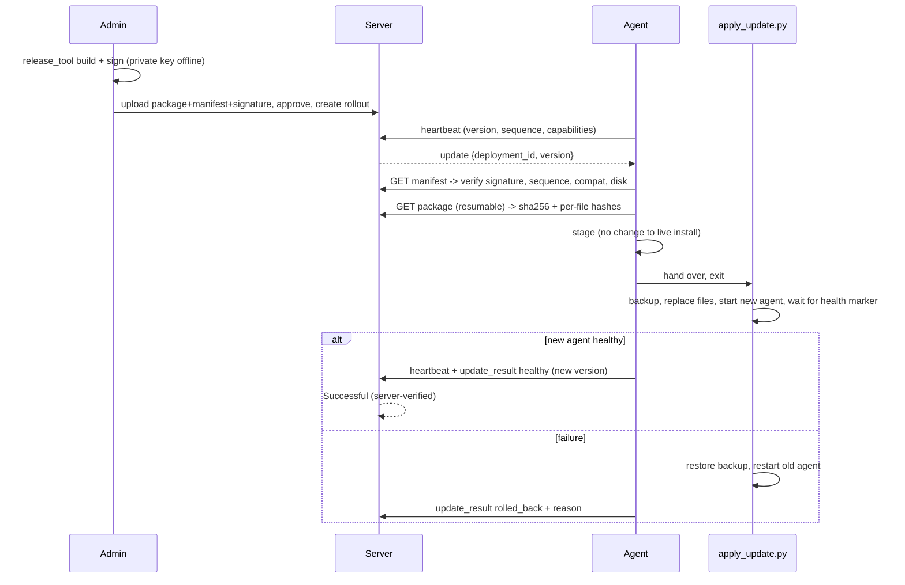

# Revamp plan — guided installer, secure enrollment, centralized signed updates

Status: **Phase 1 deliverable** (architecture + file plan). Written after inspecting the repository at commit
`abcf3f9` (see `ARCHITECTURE_ANALYSIS.md` for the full current-state analysis).

## 1. Current vs proposed

| Area | Today | Proposed |
|---|---|---|
| Install | `SETUP.bat` (console) → browser page → paste server URL, CSP code, **API key**, pick devices | Guided 5-screen Windows wizard: Welcome → CSP Name + CSP Code → devices → automatic install → summary. No key/URL/Python questions |
| Identity | admin issues key (shown once), pasted/zip-baked, stored plaintext locally | **agent generates its own key**; server stores only its hash; activated only after **authorization** (admin approval, or admin pre-approval of that CSP) |
| CSP verification | none | code + registered name checked against a server-side **CSP registry** (existing CSPs count as registered) |
| Existing CSPs | work via API key | unchanged: keys, hashes, history, config are never touched; installer upgrades in place and preserves `agent_config.json` |
| Updates | manual zip copy per PC | **outbound-only** signed updates discovered through the heartbeat: manifest → download → verify → stage → apply → restart → health check → report; automatic rollback on failure |
| Release control | none | dashboard **Agent Updates**: signed release upload, approval, pilot/expand/all, per-CSP progress, retry, pause/cancel, rollback release, history, audit |

## 2. Decisions (and why)

1. **Ed25519 signatures; private key offline.** Release packages are signed by `tools/release_tool.py` on the
   administrator's machine with a private key that is never in the repo, on the server, or on a CSP PC. The agent
   and server hold only public keys (`release_public_keys.json`). Verification uses a pure-Python RFC 8032 implementation
   (no new dependency on the CSP PC); it is tested against the RFC vector and cross-checked against the `cryptography`
   library in tests. *Trade-off:* pure Python is slower (≈ tens of ms per verify) and hand-maintained; swapping in a
   vetted library later is a one-file change.
2. **Monotonic `sequence` prevents downgrades.** Every signed manifest carries an integer `sequence`. An agent refuses
   `sequence <= installed`. A **rollback release** is therefore a *new* release (higher sequence) whose content is the old
   known-good code (`release_tool.py rollback`). The dashboard deploys it like any other. Automatic rollback after a
   failed install is local (restore the backup taken by the updater) and needs no server authority.
3. **The updater only replaces files named in the signed manifest, inside the agent folder.** No elevation, no shell,
   no PowerShell from the server, no dependency changes (a release that needs new packages is rejected by the agent with
   a "manual upgrade required" message). Per-user install under `%LOCALAPPDATA%` keeps everything writable by the user and
   avoids a privileged updater entirely.
4. **"Successful" is server-verified.** A deployment becomes *Successful* only when the **new** agent version sends a
   heartbeat carrying a healthy `update_result` for that deployment and the version in that heartbeat equals the release
   version. Assigned/downloaded/installed never count.
5. **Enrollment authorization is server-side policy,** not something the CSP types: pending request → administrator
   approves in the dashboard (or the CSP was pre-approved by the administrator). A CSP code + name alone never yields a
   credential. An enrollment for an *already registered* CSP never overwrites anything until approved, and is flagged.
6. **Installer = tkinter wizard** (stdlib; ships with python.org Python which `SETUP.bat` already installs). Logic lives in
   `installer_core.py` so it is testable without a GUI. A single-file `.exe` (PyInstaller) is *scripted but not built or tested here*.

## 3. Files — by phase

**Phase 2 (server).** New: `server/ed25519.py`, `server/registry.py` (registry + enrollment), `server/updates.py`
(releases, rollouts, deployments, state machine, targeting), `server/api_update.py` (enroll + update endpoints),
`server/templates/updates.html`, `server/templates/enrollments.html`, `server/release_public_keys.json`.
Modified: `schema.sql`, `db.py` (additive migrations), `api.py` (capabilities in, `update` out, result ingestion),
`routes.py` (Agent Updates / Enrollments / Registry pages, audited admin actions), `app.py` (blueprint, upload size
only on the upload route), `templates/base.html` (nav + styles).

**Phase 3 (agent updates).** New: `agent/ed25519.py`, `agent/release_public_keys.json`, `agent/update_client.py`,
`agent/apply_update.py`, `tools/release_tool.py` (keygen / build / sign / rollback). Modified: `reporter.py`
(capabilities, update discovery, update result), `agent.py` (post-update health verification, enrollment polling),
`config_store.py` (agent state), `version.py` (`SEQUENCE`, capability flags), `local_ui.py` (update status).

**Phase 4 (registration + installer).** New: `agent/enroll.py`, `agent/installer/installer_core.py`,
`agent/installer/wizard.py`, `agent/installer/CSP-Setup.bat`, `agent/installer/build_exe.ps1`. Modified: `SETUP.bat`
(bootstrap → launches wizard), `tools/make_csp_zips.py` (installer package with server URL + public key, no credentials).

**Phase 5/6 (tests, docs).** New tests per module; `tools/test_e2e_updates.py`; docs: `UPDATES.md`, `INSTALLER.md`,
updated `API.md`, `DEPLOYMENT.md`, `SECURITY.md`.

## 4. Database migrations (additive only; nothing dropped or rewritten)

New tables (all `CREATE TABLE IF NOT EXISTS`): `csp_registry`, `enrollments`, `agent_releases`, `rollouts`,
`update_deployments`, `csp_groups`, `csp_group_members`. New nullable `csps` columns (added with `ALTER TABLE ADD COLUMN`
in `_migrate_csps_columns`): `update_capable`, `updater_version`, `agent_sequence`. `api_keys`, `csps`, `events`,
`incidents`, `device_diagnosis`, `device_issues` data is untouched.

## 5. Flows

```mermaid
sequenceDiagram
  participant Op as Operator
  participant W as Wizard (tkinter)
  participant S as Server
  participant A as Admin (dashboard)
  Op->>W: CSP name + code
  W->>S: POST /api/enroll/verify (code, name)
  S-->>W: ok / not found / name mismatch
  Op->>W: pick devices (scan = existing device_health)
  W->>W: copy files, write config, agent generates its own key
  W->>S: POST /api/enroll (X-API-Key = new key, code, name)
  S-->>W: pending (or approved if admin pre-approved)
  A->>S: approve (audited)
  S-->>S: api_keys row = hash of that key
  W->>S: agent heartbeats; initial scan + report
```



## 6. Security boundaries
* Admin endpoints: session + CSRF + audit log. Agent endpoints: per-CSP API key; a deployment is only visible to its own CSP.
* Server can distribute but **cannot forge** a release (no private key). Tampered package/manifest → rejected by agent *and* at upload.
* Package paths are validated (no absolute paths, no `..`, allow-list of extensions, size caps); zip-slip is tested.
* Update commands are idempotent (unique per CSP+release; repeated status reports are harmless).

## 7. Deployment & recovery (summary — full procedure in `UPDATES.md`)
Server first (migrations are additive; back up `monitor.db`), then bootstrap existing CSPs **once** with the update pack
(legacy agents cannot update themselves), then all further releases are central. Recovery: failed update ⇒ local
rollback; bad release ⇒ revoke it (agents stop receiving it) and deploy a rollback release.
