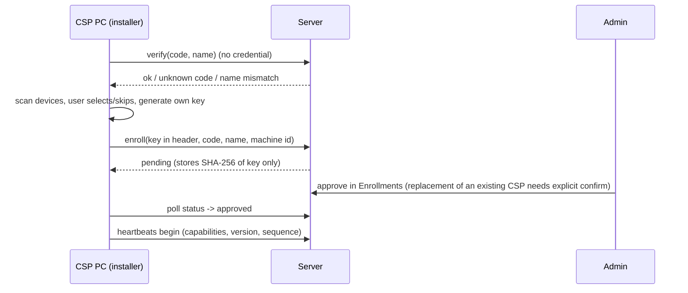
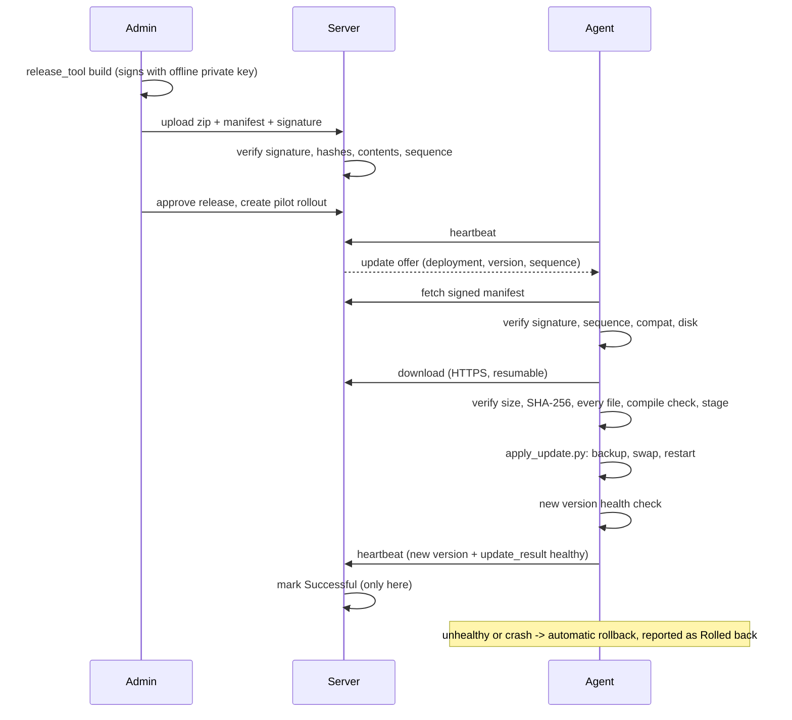

# CSP Device Monitor revamp — delivery report

Status: implemented and tested locally on the development PC. **Nothing has been deployed to a live server or CSP, no production data was touched, nothing was pushed.** See §11 for exactly what was and was not tested.

Related documents: `REVAMP_PLAN.md` (design decisions), `ARCHITECTURE_ANALYSIS.md` (full current-state analysis), `UPDATES.md`, `INSTALLER.md`, `API.md`, `SECURITY.md`, `DEPLOYMENT.md`.

## 1. Current vs proposed architecture

| | Before | After |
|---|---|---|
| Onboarding | Admin issues an API key, builds a per-CSP zip containing it (or the CSP types URL + key into a local page) | One generic installer; CSP enters **name + code**; PC makes its own key; **admin approves** |
| Credentials | Key visible to humans, sent in zips | Key generated on the PC, never shown; server keeps only a hash |
| Updating agents | Manual update packs sent to each PC | Signed releases, per-CSP/group/all rollouts from the dashboard, automatic rollback |
| Trust | Server trusted for everything | Server distributes, **cannot forge**: agents verify an Ed25519 signature against a public key they carry |
| Existing CSPs | n/a | Unchanged: same ID, key, history, devices; one-time installer run enables remote updates |

## 2. End-to-end flows

## 3. Installer screens

Real renders (sample data, no network) in `docs/installer_screens/`: `installer_1_welcome.png`, `_2_register`, `_3_devices`, `_4_install`, `_5_done`.

## 4. What was implemented (new / modified files)

**New — agent:** `agent/enroll.py`, `update_client.py`, `apply_update.py`, `ed25519.py`, `release_manifest.py`, `release_public_keys.json`, `SETUP_LEGACY.bat`, `installer/{__init__,installer_core,wizard}.py`; tests `agent/tests/test_{enroll,update_client,apply_update,ed25519,installer_core}.py`, `update_fixtures.py`.
**New — server:** `server/registry.py`, `updates.py`, `api_update.py`, `routes_updates.py`, `ed25519.py`, `release_manifest.py`, `release_public_keys.json`, `templates/updates.html`, `templates/enrollments.html`; tests `test_enrollment.py`, `test_updates.py`, `test_revamp_migration.py`, `release_fixtures.py`, `fixtures/pre_revamp_schema.sql`.
**New — tools:** `tools/release_tool.py`, `make_installer_zip.py`, `test_release_signing.py`, `test_installer_zip.py`, `test_e2e_updates.py`.
**New — docs:** `REVAMP_PLAN.md`, `REVAMP_REPORT.md`, `UPDATES.md`, `INSTALLER.md`, `ARCHITECTURE_ANALYSIS.md`, `docs/installer_screens/`.
**Modified:** `agent/{SETUP.bat,agent.py,config_store.py,local_ui.py,reporter.py,version.py}`, `server/{api.py,app.py,db.py,schema.sql,security.py,templates/base.html,tests/helpers.py}`, `tools/make_csp_zips.py`, `API.md`, `SECURITY.md`, `DEPLOYMENT.md`.

Notable fix found while testing: the per-CSP zip builder did not ship the new agent modules, which would have crashed freshly installed agents; fixed and covered by a completeness test.

## 5. Database migration

Automatic and additive at server start (`db.setup()`): new tables `csp_registry`, `enrollments`, `agent_releases`, `rollouts`, `update_deployments`, `csp_groups`, `csp_group_members` (`CREATE TABLE IF NOT EXISTS`) and three new `csps` columns `update_capable`, `updater_version`, `agent_sequence` (`ALTER TABLE ADD COLUMN`, NULL for legacy). No existing row, key or hash is rewritten. Idempotent. Proven by `test_revamp_migration.py` against a frozen pre-revamp schema with data. **Back up `monitor.db` before the first start of the new server** (`cp monitor.db monitor.db.bak`; the migration is additive but a backup is cheap).

## 6. API

See `API.md`: heartbeat additions (`capabilities`, `agent_sequence`, `update_result`; reply `update`), `/api/enroll/verify`, `/api/enroll`, `/api/enroll/status`, `/api/update/manifest`, `/api/update/package`, `/api/update/status`, and the admin routes.

## 7. Installation and enrollment instructions
See `INSTALLER.md`.

## 8. Existing CSPs — bootstrap / migration
Existing CSPs are untouched by the server upgrade: same IDs, names, keys, device choices, diagnosis history, incidents, dashboard. Legacy agents keep reporting; the dashboard marks them *needs one-time upgrade* and never targets them. Upgrade one CSP at a time by sending the generic installer (`make_installer_zip.py`); on a PC that already has an agent it keeps identity/key/devices/history and does not enroll again. **Legacy agents cannot update themselves**; the first upgrade is necessarily manual. Keys are never rotated for this. Detail in `UPDATES.md` §6.

## 9. Admin release and rollout
See `UPDATES.md` §1–§5.

## 10. Security and rollback
See `SECURITY.md` (new section) and `UPDATES.md` §4, §5, §7. Rollback is automatic on the PC (backup restore) and administrative via a new higher-sequence re-signed release of the old code.

## 11. Test results and known limitations

Run on this development PC (Windows 11, Python), all passing at the time of writing:

| Suite | Result |
|---|---|
| `agent/tests` | 322 tests, OK |
| `server/tests` | 212 tests, OK (211 + `test_revamp_migration`) |
| `tools/` (release signing, installer zip, address-switch, e2e diagnosis, **e2e updates**) | 51 tests, OK |

The end-to-end test (`tools/test_e2e_updates.py`) runs the real Flask server over real HTTP on `127.0.0.1` against the real agent modules and covers: registration rules (invalid code, name mismatch, case/whitespace-insensitive match), an unapproved key being rejected (401), key stored only hashed, no duplicate enrollment records, a second PC not replacing an enrolled CSP, a full successful update (assigned ≠ success; **Successful only after the new version's healthy heartbeat**; the PC's own history preserved; audit entries written), a crashing update rolling back and being reported as Rolled back, a forged release refused by the server and a tampered package refused by the agent, an agent trusting a different key refusing to install, duplicate rollout commands creating no duplicate work, and a legacy API-key-only agent being unaffected and never targeted. Earlier mutation testing (19 injected faults in signature/path/rollback code, all caught) is recorded in the earlier session; it was **not** re-run for the installer.

**Not tested / limitations — be aware before production:**
* The installer was **not** run end-to-end on a clean Windows PC. Verified instead: the engine with fakes (19 tests), the real device scan on this PC, the five wizard screens rendered and self-tested, the zip contents. Python auto-install, the Startup launcher on a fresh profile, and a real first heartbeat from an installed PC are unverified.
* The applier/restart was exercised with real subprocesses (earlier tests) and in-process with a simulated "new process starts"; a real agent restarting under Windows with antivirus present was not tested. There is **no Windows service and no elevated updater** by design (per-user Startup install); an agent only runs while the user's profile is logged in.
* No `.exe` installer is built (Python-based, launched by `SETUP.bat`). No code signing of the installer, so Windows SmartScreen may warn.
* No rollout has been done on any real CSP and no server deploy: the server login available lacks sudo (blocked outside this work).
* Only the Ed25519 signature protects against a malicious server; an admin who holds the signing key can deploy anything. Key backup/rotation procedure is manual.
* Legacy agents need the one-time manual upgrade; there is no remote way to give them an updater.

## 12. Production deployment checklist

1. Back up `monitor.db` and the Docker volume.
2. `release_tool.py keygen` on a secure admin PC; store the private key offline with a backup; put the **public** key in `agent/` and `server/` (or `CSP_MONITOR_RELEASE_PUBKEYS`).
3. Set `CSP_MONITOR_RELEASE_DIR` on the persistent volume; confirm HTTPS + `CSP_MONITOR_FORCE_HTTPS=1`.
4. Deploy the server (needs sudo/docker access); open the dashboard, confirm existing CSPs and API keys appear unchanged and **Agent Updates** / **Enrollments** load.
5. Import the CSP registry (code,name) into **Enrollments**; decide pre-approval per CSP.
6. Build the installer zip with the final server URL (re-check after the domain migration; the URL is inside the zip); test it on one clean Windows PC first.
7. Pilot: upgrade 1–2 friendly existing CSPs with the installer; confirm identity/key/history preserved and they show *update-capable*.
8. Build + sign a trivial release (e.g. 2.0.1), upload, approve, **pilot rollout** to those CSPs, confirm *Successful*; test a rollback release.
9. Expand rollout in stages; keep the rollback ready.
10. Rotate nothing; keep legacy keys valid until each CSP is upgraded.
